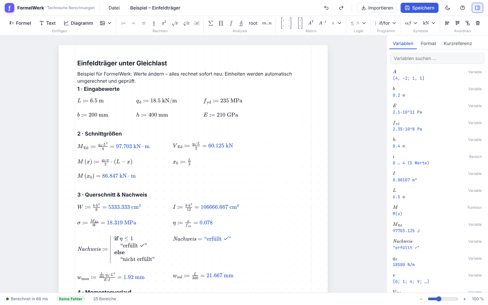
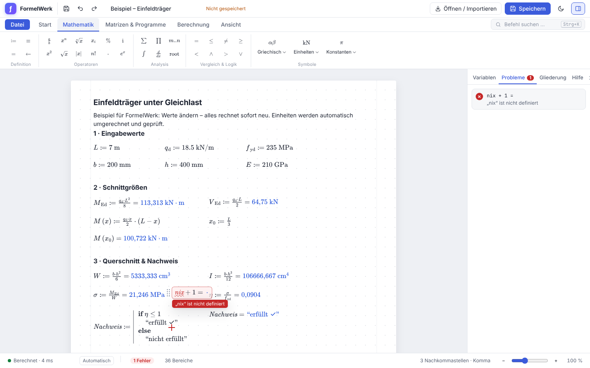
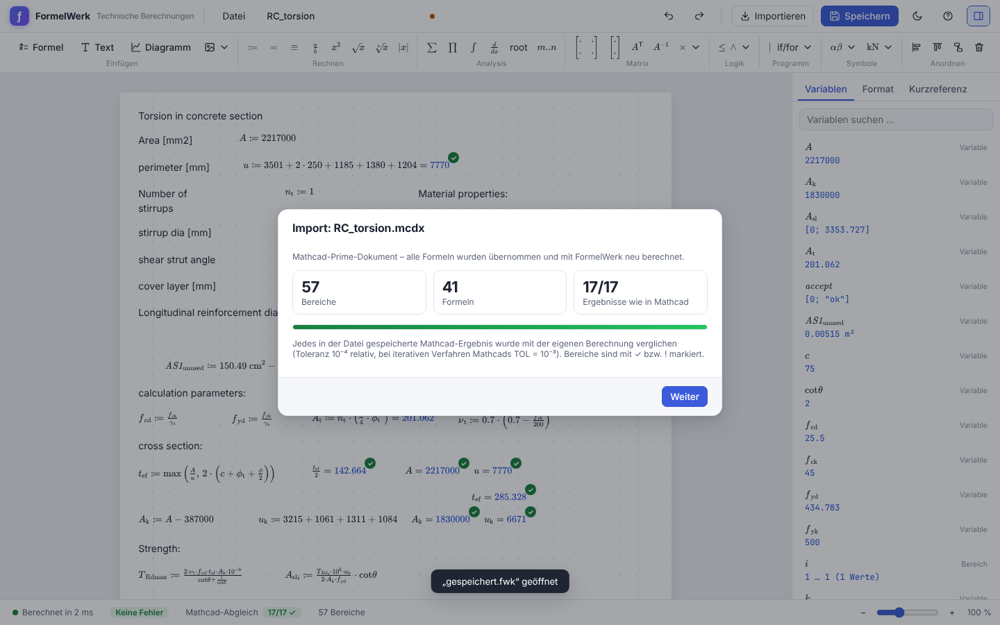

# FormelWerk

**Technische Berechnungen im Stil von Mathcad – modern, schnell, im Browser. Mit Import bestehender Mathcad-Dateien.**

Formeln stehen frei auf einem Arbeitsblatt, werden in mathematischer Schreibweise dargestellt und bei jeder Änderung sofort neu berechnet – mit Einheiten, Matrizen, Funktionen, Programmen, Integralen, Gleichungssystemen und Diagrammen.



## Schnellstart

```bash
npm install
npm run dev        # Entwicklungsserver, http://localhost:5173
npm run build      # Produktionsversion nach dist/
npm run preview    # gebaute Version ansehen
```

Voraussetzung: Node.js ≥ 20. Die App läuft komplett im Browser, es werden keine Daten an einen Server geschickt.

## Bedienung

| Aktion | So geht's |
|---|---|
| Formel eingeben | irgendwo aufs Blatt klicken und tippen – oder Doppelklick |
| Definition | `a:5 m` – der Doppelpunkt wird automatisch zu `:=` |
| Ergebnis | `a*b =` |
| Ergebnis in Wunscheinheit | `F = kN`, `σ = N/mm^2`, `T = °C` |
| Definieren und anzeigen | `M := q*L^2/8 = kN*m` |
| Globale Definition | `g ≡ 9.81 m/s^2` (Taste `~`) |
| Funktion | `f(x) := x^2 + 1` |
| Index im Namen | `F_max`, `σ_c.d` |
| Text | `"` tippen oder Menüband → Text |
| Formel abschließen | `Enter` – das rote Kreuz springt darunter, weiter tippen |
| Griechische Buchstaben | `\alpha` + Leertaste, `Strg+G` (a → α) oder Palette |
| Vorschläge | erscheinen beim Tippen, `Tab` übernimmt |

### Wenig Klicks, viel Ergebnis

| Aktion | So geht's |
|---|---|
| Einheit eines Ergebnisses ändern | **auf das Ergebnis klicken** → passende Einheiten (z. B. `J`, `kN·m`, `N·mm`) oder eigene eintippen; „Auto (SI)“ entfernt sie wieder. Im selben Fenster: Ergebnis kopieren, Nachkommastellen ± |
| Funktion zeichnen | Rechtsklick auf `f(x) := …` → *Diagramm von f(x) einfügen* – oder Funktion markieren und `@` |
| Gleichung lösen | `a*y + 1 == 10` tippen, Rechtsklick → *Gleichung nach y lösen*: legt Startwert, `Given`, Gleichung und `y := Find(y) =` an; der Startwert bekommt automatisch die passende Einheit |
| Wert einer Definition zeigen | Rechtsklick → *Wert anzeigen* / *Wert ausblenden* (hängt `=` an bzw. entfernt es); alle auf einmal: *Ansicht → Werte zeigen* (grau, wird nicht gedruckt); der Wert steht außerdem im Tooltip |
| Vorlagen wie in Mathcad | `@` X-Y-Diagramm, `$` Summe, `&` Integral, `Strg+M` Matrix 3×3 – `Tab` springt zum nächsten Platzhalter |

### Oberfläche



- **Menüband mit Registerkarten** wie in Office/Mathcad Prime: *Start* (Zwischenablage, Bereiche, Bearbeiten, Anordnen), *Mathematik* (Operatoren, Analysis, Logik, griechische Buchstaben, Einheiten, Konstanten), *Matrizen & Programme* (Matrix mit Größenwähler, Matrixfunktionen, if/for/while, Solve-Blöcke), *Berechnung* (Jetzt berechnen, automatisch/manuell, Nachkommastellen, Exponentialschwelle, Dezimalpunkt/-komma, Startindex), *Ansicht* (Zoom, Raster, Werte von Definitionen, Seitenleiste, Hell/Dunkel).
- **Befehlspalette** `Strg+K`: jeden Befehl per Suchbegriff finden und ausführen.
- **Kontextmenü** per Rechtsklick auf Bereiche (je nach Formel: Diagramm der Funktion, Gleichung lösen, Wert anzeigen, Einheit ändern, Ergebnis kopieren; außerdem Bearbeiten, Auswertung deaktivieren, Kopieren, Duplizieren, Ausrichten, Löschen) und auf die leere Seite (Formel/Text/Diagramm hier einfügen).
- **Seitenleiste**: *Variablen* mit aktuellen Werten, *Probleme* (alle Fehler und Abweichungen zu Mathcad, Klick springt hin), *Gliederung* aus den Überschriften, *Hilfe* mit der kompletten Syntax.
- **Statusleiste** mit Berechnungsfortschritt, Modus automatisch/manuell (`F9` rechnet), Fehlerzahl, Mathcad-Abgleich und Zoom. Bereiche, die gerade neu berechnet werden, sind gedimmt markiert.

Tastenkürzel: `Strg+K` (Befehle), `F9` (Berechnen), `F1` (Hilfe), `Strg+Z/Y` (Rückgängig/Wiederholen), `Strg+C/X/V/D` (Kopieren/Ausschneiden/Einfügen/Duplizieren), Pfeiltasten (Auswahl oder Kreuz verschieben), `Entf`, `Strg+S` (Speichern), `Strg+O` (Öffnen), `Strg+P` (Drucken/PDF), `Strg ±` (Zoom). Bereiche lassen sich mit der Maus verschieben, per Rahmen mehrfach auswählen, ausrichten und mit „Bereiche trennen“ entzerren.

### Geschwindigkeit

- **Inkrementelle Berechnung**: Nach einer Änderung wird nur ab dem geänderten Bereich neu gerechnet (wie in Mathcad); der Zustand davor wird aus Zwischenständen übernommen. Ergebnisse sind nachweislich identisch zur Vollberechnung (`tests/incremental.test.ts`).
- **Unterbrechbar**: Die Berechnung läuft in Zeitscheiben in einem Web Worker. Tippt man weiter, wird die laufende Rechnung abgebrochen und ab der neuen Änderung fortgesetzt – die Oberfläche bleibt immer bedienbar.
- **Schneller Rechenkern** für Größen mit Einheiten, elementweise Matrixoperationen und wachsende Vektoren.

Messung (`npx tsx scripts/bench.mts`, Node 22):

| Arbeitsblatt | vorher | jetzt | Änderung am Ende |
|---|---:|---:|---:|
| RC_col (280 Bereiche, Solve-Block) | 1 233 ms | 445 ms | 3 ms |
| biaxial_bending (Doppelintegrale im Solve-Block) | 20 242 ms | 4 635 ms | 1 ms |
| statistics | 16 050 ms | 1 038 ms | 7 ms |
| probability | 10 783 ms | 458 ms | 5 ms |
| alle Testblätter zusammen | 51 437 ms | 9 295 ms | – |

### Sprachumfang

- **Zahlen & Einheiten**: SI und angloamerikanische Einheiten (`mm`, `kN`, `MPa`, `kip`, `psi`, `°C`, `kWh`, `rpm` …), automatische Umrechnung und Prüfung der Dimensionen; Ergebnisse in sinnvollen SI-Einheiten (N, Pa, J, W, kg/m³ …). `'m` erzwingt die Einheit, falls eine Variable `m` existiert.
- **Operatoren**: `+ - * / ^`, `√( )`, `nthroot(x, n)`, `|x|` (Betrag/Länge/Determinante), `n!`, `%`, Vergleiche `== ≠ < > ≤ ≥` (auch verkettet `a ≤ x < b`), Logik `∧ ∨ ¬ ⊕`.
- **Komplexe Zahlen**: `3 + 4i`.
- **Vektoren & Matrizen**: `[1, 2; 3, 4]`, Elemente `v[i]`, `A[i, j]` (ORIGIN 0, einstellbar), Spalten `A<<j>>`, `A^T`, `A^-1`, Kreuzprodukt `×`, Vektorisierung `vec( )`, Mehrfachzuweisung `[a; b] := v`, verschachtelte Felder.
- **Bereichsvariablen**: `i := 0..10`, `x := 0, 0.1 .. 2`, implizite Iteration (`v[i] := i^2`, `i^2 =`).
- **Analysis**: `sum(f, i, a, b)`, `prod(…)`, `int(f, x, a, b)` (adaptive Gauß-Kronrod, auch ±∞ und mit Einheiten), `deriv(f, x [, n])`, `root(f, x)` / `root(f, x, a, b)`, `polyroots(v)`.
- **Gleichungssysteme**: Solve-Blöcke `Given` … Bedingungen mit `==`, `<`, `>` … `Find(x, y)` / `Minerr` – auch als Funktion `f(a, b) := Find(x)`.
- **Programme** (mehrzeilig, eingerückt): `if / else if / else`, `for i ∈ …`, `while`, `break`, `continue`, `return`, `try / on error`, lokale Zuweisung `←`.
- **Funktionsbibliothek** (> 200 Funktionen): Trigonometrie/Hyperbolik, `ln`, `log`, `exp`, Rundung (`round`, `Ceil`, `Floor`, `mod` …), Statistik (`mean`, `median`, `stdev`, `Stdev`, `var`, `percentile`, `corr`, `slope` …), Verteilungen (`dnorm/pnorm/qnorm/rnorm`, ebenso `t`, `chisq`, `F`, `beta`, `gamma`, `binom`, `pois`, `unif`, `exp`, `lnorm`, `weibull` …), Lineare Algebra (`lsolve`, `eigenvals`, `eigenvecs`, `rank`, `rref`, `geninv`, `cond2` …), Matrixaufbau (`augment`, `stack`, `submatrix`, `identity`, `diag`, `sort`, `csort` …), Interpolation `linterp`, Suche (`match`, `lookup`, `vlookup`), Zeichenketten.
- **Diagramme**: X-Y-Diagramme aus Bereichsvariablen, Vektoren oder als Schnelldiagramm (nicht definierte x-Variable wird automatisch abgetastet), mehrere Kurven, Achseneinheiten, logarithmische Achsen, Werte-Anzeige beim Überfahren.
- **Ergebnisformat**: Nachkommastellen, Exponentialschwelle, ORIGIN, Schriftgröße (Seitenleiste → Format).

### Dateien

- **Speichern/Öffnen** im eigenen Format `.fwk` (JSON). Zusätzlich automatische Sicherung im Browser.
- **Export** als eigenständige HTML-Seite oder **Drucken / PDF** (A4).
- **Hell- und Dunkelmodus**, Zoom, Drag & Drop von Dateien auf das Fenster.

## Import von Mathcad-Dateien

| Format | Version | Unterstützung |
|---|---|---|
| `.xmcd` | Mathcad 11 – 15 (XML) | Formeln, Funktionen, Programme, Bereichsvariablen, Matrizen, Einheiten, Text (mit Formatierung), Bilder, Seitenumbrüche, Rechenreihenfolge (Grundlinie), ORIGIN, Nachkommastellen. Diagramme werden als Bild übernommen, weil Mathcad 15 sie binär speichert. |
| `.mcdx` | Mathcad Prime (alle Versionen) | Wie oben, zusätzlich echte (editierbare) Diagramme, Solve-Blöcke, Datentabellen, Auswahllisten/Steuerelemente (als feste Werte), Bereiche in Klappbereichen, physikalische Konstanten (`'k`, `'N_A` …), getrennte Einheiten-/Variablennamen. |
| `.mcd` | Mathcad ≤ 11 (binär) | Nicht offengelegtes Binärformat – bitte in Mathcad als `.xmcd` speichern, dann importieren. Die App zeigt dazu einen Hinweis. |



Nach dem Import erscheint ein **Importbericht**: FormelWerk rechnet das Dokument komplett neu und **vergleicht jedes in der Datei gespeicherte Mathcad-Ergebnis mit der eigenen Berechnung**. Übereinstimmende Bereiche tragen ein ✓, Abweichungen ein ! mit beiden Werten im Tooltip; die Statusleiste zeigt die Quote (z. B. „Mathcad-Abgleich 87/87 ✓“). Überlappungen durch andere Schriftbreiten werden automatisch entzerrt, ohne die Rechenreihenfolge zu ändern.

Nicht übernommen werden können: symbolische Auswertungen (das von Mathcad gespeicherte symbolische Ergebnis wird angezeigt), Funktionen aus externen DLLs/Add-ins (z. B. REFPROP), Verweise auf andere Arbeitsblätter, OLE-Objekte (als Bild, falls vorhanden) sowie einige Spezialfunktionen (z. B. `Spline2`, `interp`/`cspline`). Solche Bereiche werden markiert übernommen und im Bericht aufgeführt.

## Verifikation

Die Ergebnisse wurden auf mehreren Ebenen geprüft:

1. **Unit-Tests des Rechenkerns** (`tests/engine.test.ts`): Parser, Rundlauf Text ↔ Syntaxbaum, Arithmetik, Einheiten, Matrizen, Bereichsvariablen, Integrale, Ableitungen, Nullstellen, Solve-Blöcke, Programme, Formatierung, KaTeX-Darstellbarkeit, Beispielblatt – alle Sollwerte von Hand nachgerechnet.
2. **Abgleich mit echten Mathcad-Ergebnissen** (`tests/import.verify.test.ts`):
   - 36 Mathcad-Prime-Dateien (`tests/fixtures/mathcad/prime`, MIT-Lizenz, aus [mcad2py](https://github.com/ChristianCruger/mcad2py)): **alle 587 von 587** gespeicherten Ergebnissen reproduziert (100 %) – alle 36 Dateien vollständig, darunter Stahlbeton-Nachweise mit Doppelintegralen und Solve-Blöcken (`RC_col` 96/96, `biaxial_bending` 4/4), Statistik, Matrizen/Eigenwertprobleme und Interpolation. `Spline2` folgt dem Suchverfahren von Thijsse, Hollanders und Hendrikse (Computers in Physics 12, 1998), das Mathcads Funktion zugrunde liegt (eigene Umsetzung nach der veröffentlichten Beschreibung). Formeln, die nicht übernommen werden können, zählen als „nicht reproduziert“. Eigenvektoren sind nur bis auf das Vorzeichen bestimmt; Ergebnisse, die von Eigenvektoren abhängen, werden daher spaltenweise bis auf ±1 verglichen. Zufallszahlen sind vom Abgleich ausgenommen (Mathcads Zufallsgenerator ist nicht nachbildbar), ebenso Skript-Steuerelemente und gespeicherte Werte, die sich nicht lesen lassen. Die vollständige Liste schreibt der Test nach `test-results/mathcad-prime-verifikation.txt`.
   - Handgeschriebenes Mathcad-15-Dokument (`beispiel_mathcad15.xmcd`): 7/7.
   - Zusätzlich lokal geprüft: 9 reale Mathcad-14/15-Arbeitsblätter aus öffentlichen GitHub-Projekten – **37 von 40** Ergebnissen identisch (die 3 übrigen rufen eine externe REFPROP-DLL auf). Eigene Dateien lassen sich genauso prüfen: `MATHCAD_SAMPLES=/pfad/zu/dateien npm run verify:mathcad`.
3. **Inkrementelle Berechnung** (`tests/incremental.test.ts`): Auf sieben Arbeitsblättern werden je 17 Änderungsarten (Bearbeiten, Löschen, Verschieben, Format) inkrementell und vollständig berechnet – die Ergebnisse müssen exakt übereinstimmen; ebenso nach einer unterbrochenen Berechnung.
4. **Fehlersuche durch 10 unabhängige Test-Agenten** (Parser/Format, Einheiten, Matrizen, Solver/Programme, Numerik gegen scipy/mpmath, inkrementelle Berechnung/Performance, Import, Bedienung, Menüs/Dateien, Sicherheit): jeder bestätigte Fund wurde behoben und ist in `tests/engine.test.ts` bzw. `tests/import.verify.test.ts` („Befunde der Testagenten …“) als Regressionstest abgesichert.
5. **End-to-End-Test im Browser** (`e2e/run.mjs`, Playwright/Chromium): Eingabe per Tastatur inkl. `:`→`:=`, Ergebnisse und Einheiten, Fehlermeldungen, Rückgängig/Wiederholen, Autovervollständigung, griechische Buchstaben, mehrzeilige Programme, Diagramme, Speichern/Öffnen, Import von `.xmcd`/`.mcdx` mit Ergebnisabgleich, Dunkelmodus, Befehlspalette, Kontextmenü, manuelle Berechnung mit F9, Probleme-Liste, Gliederung, Reaktionszeit auf großen Blättern, Hinweis bei `.mcd`, keine JavaScript-Fehler.

```bash
npm test                         # Unit- und Import-Verifikation
npm run build && npm run e2e     # Browser-Test, Screenshots in e2e/out/
```

## Architektur

```
src/engine/   Rechenkern (unabhängig von der Oberfläche)
  parser.ts      Text-Syntax → Syntaxbaum (inkl. eingerückter Programme)
  evaluator.ts   Auswertung (mathjs für komplexe Zahlen/Matrixalgebra)
  quantity.ts    schnelle Arithmetik für Größen mit Einheiten
  builtins.ts    Funktionsbibliothek, Solve-Blöcke, Konstanten
  numeric.ts     Integration, Ableitung, Nullstellen, Levenberg-Marquardt
  stats.ts       Spezielle Funktionen und Verteilungen
  worksheet.ts   Rechenreihenfolge, inkrementelle/unterbrechbare Berechnung, Bereichsvariablen, Diagrammdaten
  format.ts      Zahlen- und Einheitenformatierung
  latex.ts       Syntaxbaum → LaTeX (Darstellung mit KaTeX)
  verify.ts      Vergleich mit gespeicherten Mathcad-Ergebnissen
src/import/   Mathcad-Import (math30/math50-XML → Syntaxbaum → Text)
src/ui/       React-Oberfläche; Berechnung läuft in einem Web Worker
  actions.ts     zentrale Befehle (Menüband, Kontextmenü, Befehlspalette, Tastenkürzel)
  smart.ts       Formel-Umschreibungen für Einheitenwahl, Wert anzeigen, Diagramm aus Funktion, Gleichung lösen
```

## Lizenz

MIT – siehe [LICENSE](LICENSE). Testdateien unter `tests/fixtures/mathcad/prime` stehen unter der MIT-Lizenz ihres Ursprungsprojekts (siehe dortige `LICENSE-mcad2py`).
